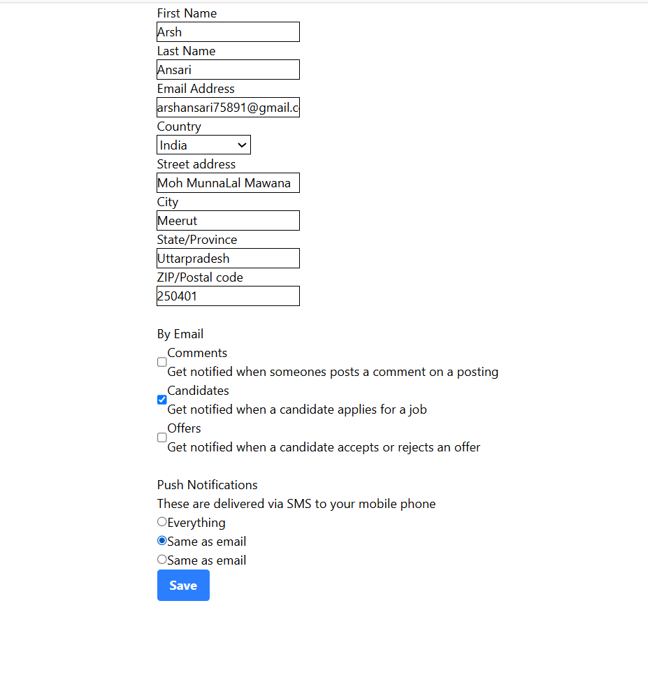

# 📝 React Form App

A responsive React form application that demonstrates handling different types of form inputs using controlled components. The project includes text inputs, dropdowns, checkboxes, radio buttons, and form state management with a clean and user-friendly interface.

---

## ✨ Features

- 📝 User Registration Form
- 👤 First Name & Last Name
- 📧 Email Address
- 🌍 Country Selection
- 🏠 Address Details
- 🏙️ City, State & ZIP Code
- 📬 Email Notification Preferences
- 📱 Push Notification Options
- ⚡ Real-time Form State Management
- 📱 Responsive User Interface

---

## 🛠️ Tech Stack

- ⚛️ React
- 🟨 JavaScript (ES6+)
- 🎨 CSS3
- ⚡ Vite
- 🌿 Git & GitHub

---

## 🌐 Live Demo

🔗 **Coming Soon** *(Will be updated after Vercel deployment)*

---

## 📂 Project Structure

```text
src/
├── App.jsx
├── App.css
├── index.css
└── main.jsx
```

---

## 📸 Project Screenshot



---

## 🚀 Getting Started

### Clone the repository

```bash
git clone https://github.com/Arsh173/react-form-app.git
```

### Navigate to the project folder

```bash
cd react-form-app
```

### Install dependencies

```bash
npm install
```

### Start the development server

```bash
npm run dev
```

---

## 📚 React Concepts Practiced

- Functional Components
- Controlled Components
- useState Hook
- Form Handling
- Event Handling
- Conditional Rendering
- Radio Buttons
- Checkboxes
- Select Dropdown
- Input Validation Basics

---

## 🎯 Future Improvements

- ✅ Form Validation
- 📧 Email Format Validation
- 📱 Mobile Responsive Enhancements
- 🔥 Toast Notifications
- 💾 Backend Integration
- 🗄️ Store Form Data in Database

---

## 👨‍💻 Author

**Arsh**

- GitHub: https://github.com/Arsh173
- LinkedIn: https://linkedin.com/in/arsh0786

---

## ⭐ Support

If you found this project helpful, consider giving it a ⭐ on GitHub!